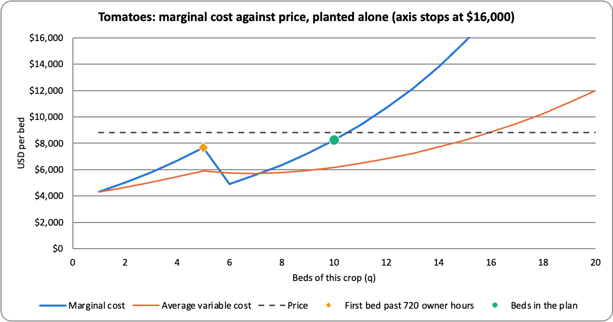
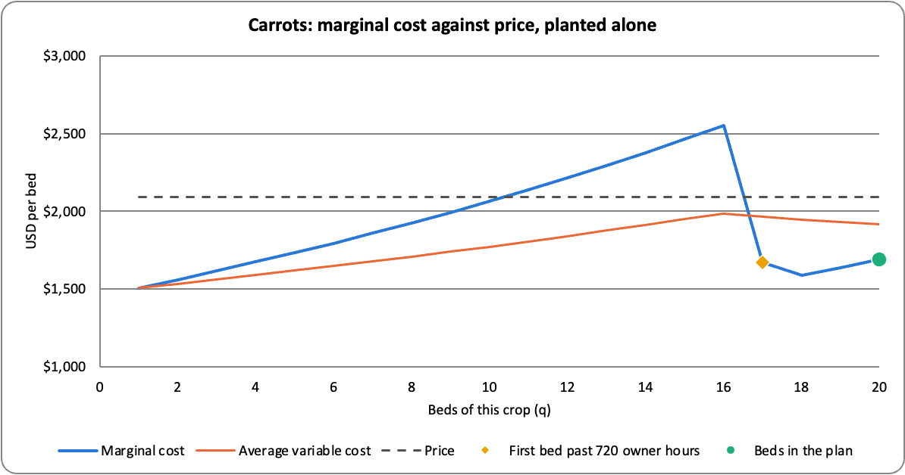
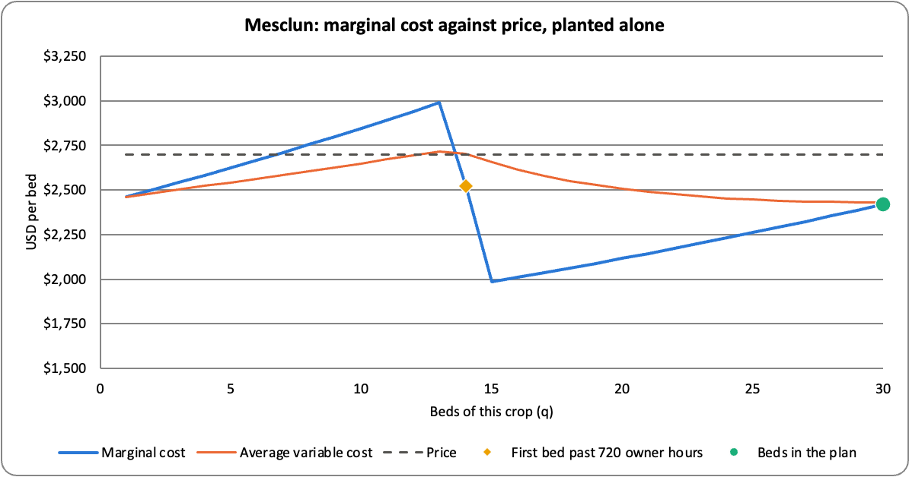

# Perfect competition — analysis

## Tomato Bed Limit

Tomatoes earn the most per bed ($8,800 vs $2,700 and $2,094; `Model!B19`, `B29`, `B24`) but only 10 of 20 beds get planted (`Model!B35`, `B18`). The cost per bed increases at the 11th bed to the point that it outweighs the price.
Bed 10 costs $8,248.59 so price minus MC is $551.41 (`Schedules!D15`, `Analysis!H5`).
Bed 11 would be $9,390.72 so price minus MC is -$590.72 (`Schedules!D16`, `Analysis!J5`).
The model stops at 10 beds because the cost of an eleventh bed would outweigh price. See the tomato figure below.

## Carrot and Mesclun Maximally Planted

Both Carrot and Mesclun were planted in 20/20 and 30/30 beds, respectively.

- The price of carrot is $2,094, MC is $1,688.95 (`Model!B24`, `Schedules!D50`)
- The price of mesclun is $2,700, MC is $2,420.10 (`Model!B29`, `Schedules!D85`)

The cap is what stops us from planting more of each crop.
If we planted another bed of each, Carrot would be $352.49 (+ profit) and Mesclun would be $246.47 (+ profit) (`Analysis!J6`, `J7`).

- Tomato cap: 10 of 20 (`Model!B35`, `B18`)
- Total beds: 60 of 64 (`Model!B38`, `B5`)
- Temp workers 3.16 of 4 (`Model!B47`, `B12`)

Adding more of any of them adds $0 because they are slack (`Analysis!F11`, `F14`, `F15`).

## Marginal cost falls because hours cost $17.36 from temp workers after using all the owner's hours at $34.72.

- Tomato: 5-6 ($7,661 to $4,906; `Analysis!H20`, `I20`)
- Carrots: 16-18 ($2,552 to $1,589; `Analysis!G21`, `I21`)
- Mesclun: 13-15 ($2,988 to $1,984; `Analysis!G22`, `I22`)

1. The physical returns did not improve. The cost just decreased.
2. MC reflects all the material, supplies, and labor. What changed was the price of the wage (`Model!B11`, `B15`). See the carrot and mesclun figures below.

## Only Tomato Makes Money Alone

Tomato would make money alone but Carrot and Mesclun would lose money (`Analysis!G26:G28`).
The 20K (`Model!B4`) isn't the issue. It's owed whether or not another bed is planted.
Price is above AVC for carrot and mesclun (`Analysis!M27`, `M28`). Each bed pays for itself with extra toward the 20K.

## Limitations

The temps are hourly. If they have to be paid for the whole season, profit for the 10/20/30 split goes down from $42,761.66 to $21,880 (`Model!B63`, `Analysis!S41`). That means the profit number has a large variance, depending on a single factor.

## Tomato, Mesclun, Total Count Mistakes

I predicted 20/20/24 vs 10/20/30 on 60 beds (`Model!B35:B38`).
Bed 11 cost too much for tomato. So we won't plant more than 10.
I assumed all beds should be planted. That wasn't true because of the way the costs built up. 60 were best.
I also thought mesclun wouldn't be planted as much (24 vs 30) due to high fertilizer cost. This turned out to be incorrect. Mesclun's price stays above MC up to 30 beds+ in the combined plan (`Schedules!D85`).
